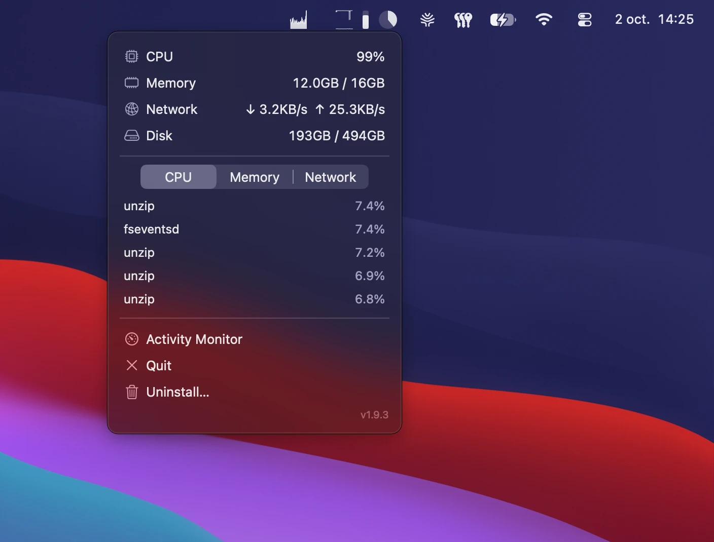

# Stats

A lightweight macOS menu bar app that keeps essential system metrics always visible at a glance.



## What it does

Stats lives in your menu bar and displays four widgets side by side:

- **CPU usage** — A rolling line chart showing your processor activity over the last 5 minutes, on a fixed 0–100% scale.
- **Network speed** — A mirrored chart showing upload speed on top and download speed on the bottom, on a square-root scale so light traffic stays visible after a burst. Loopback, VPN tunnels and VM bridges are ignored so traffic is neither inflated by local connections nor counted twice.
- **Memory** — A vertical gauge filled to the share of RAM in use.
- **Disk space** — A pie chart showing how much storage is used vs available on your main drive (purgeable space counts as available, like in Finder).

Clicking on the menu bar icon opens a popover, updated live while it is open:

- **Live figures** — CPU %, memory used / total, current download and upload speed, and disk used / total.
- **Top apps** — the five heaviest apps by CPU (as a share of the whole machine, measured since the previous refresh like Activity Monitor), memory, or network traffic over the last 5 minutes. Each row is an app with everything it launched (Claude with its helpers and the tools it runs, a simulator with its daemons). Your own apps have a ✕ button to quit them. Hover the Network and Disk tabs for the period they cover.
- **Disk activity** — the Disk tab lists the five apps that read (R) and wrote (W) the most over the last 5 minutes. macOS only reports disk activity per process to their owner, so this tab covers your own apps; system processes (Spotlight indexing, backups, kernel) are not counted.
- Quick actions (Activity Monitor, Quit Stats) and the app version. The app checks for updates automatically and shows an update button in the popover when a new version is available.

Click anywhere else to close the popover. **Right-click** the menu bar icon (or Control-click it) for a menu with **Uninstall…** and **Quit Stats**. With VoiceOver, the menu bar icon reads the four figures.

The app starts automatically at login and runs silently in the background with no dock icon or window.

## Install

### Download

1. Download [`Stats.dmg`](https://github.com/moifort/minimal-stats/releases/latest/download/Stats.dmg) from the [latest release](https://github.com/moifort/minimal-stats/releases/latest)
2. Open it and drag **Stats** onto **Applications**
3. Open Stats from Applications: it is signed with a Developer ID and notarized by Apple, so it opens like any other app

Requires macOS 26 or later on a Mac with Apple silicon.

### Homebrew

```sh
brew install --cask moifort/tap/minimal-stats
```

### From source

Requires Xcode command line tools and macOS 26+.

```sh
git clone https://github.com/moifort/minimal-stats.git
cd minimal-stats
make install VERSION=1.0.0
```

This builds the app and copies it to `/Applications`.

## Update

The app checks for updates automatically once a day. When a new version is available, an update button appears in the popover. Clicking it shows the changelog and installs the update in-place — no need to re-download manually.

### Uninstall

Right-click the menu bar icon and select **Uninstall…** — this removes the login item and moves the app to the Trash. You can also manually delete `Stats.app` from your Applications folder.

## License

[MIT](LICENSE), © 2026 Polyforms.
